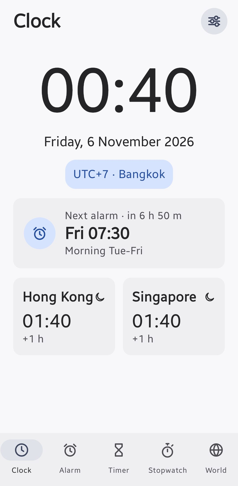
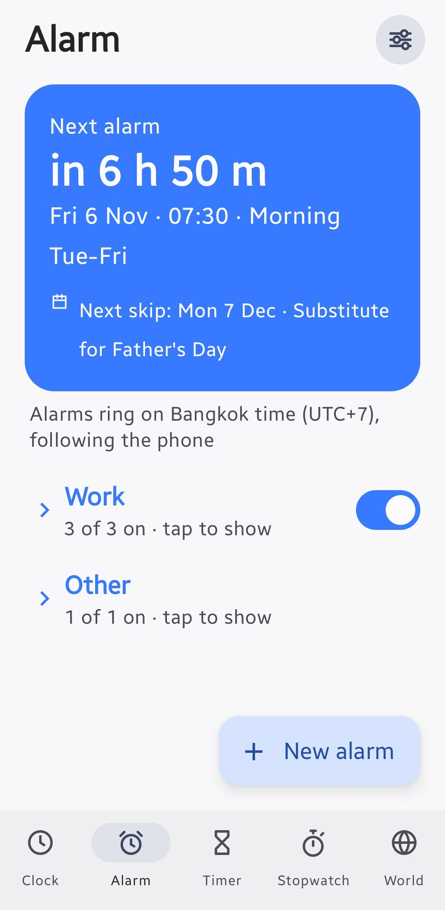
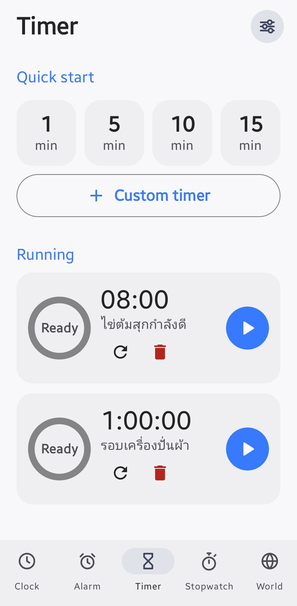
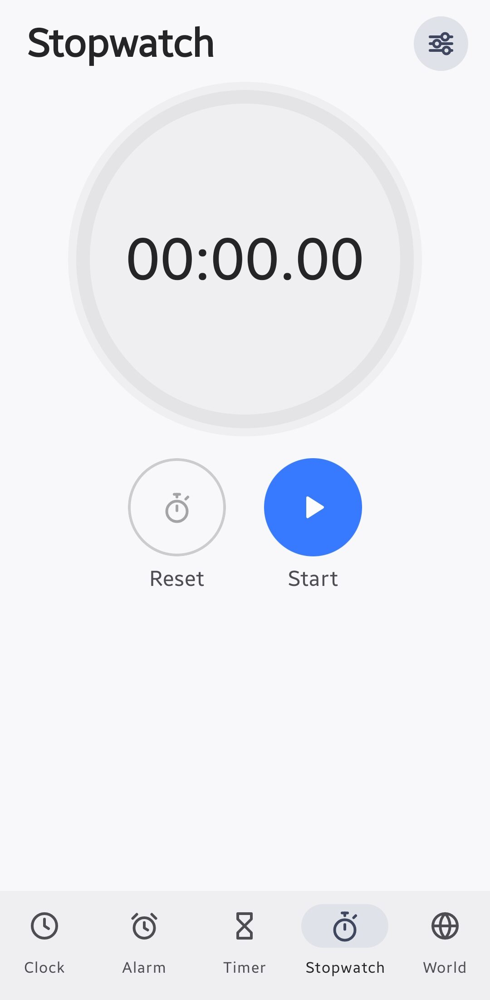
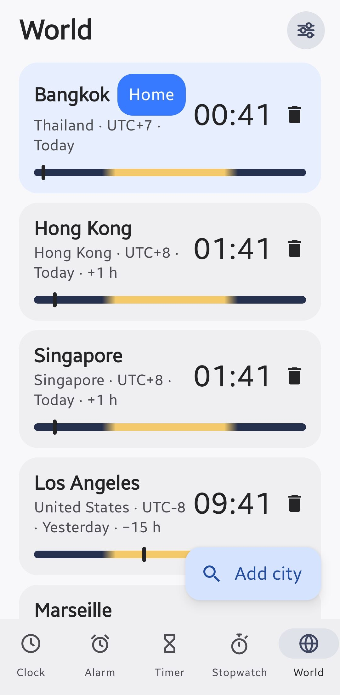

# Personal Clock

A single-user, **fully offline** Android clock for a Samsung phone (One UI), built to replace the stock
clock widget that started showing seconds.

- **Widget with no seconds**, fully customizable (font, size, alignment, background, opacity, colours, 12/24h, date above/below the time, next alarm, second city clock, corner radius, padding, shadow, tap action) with a live preview. Each placed widget has its own settings.
- **Alarms** on a work schedule that can **skip public holidays of any country** (phone holiday calendar or a built-in list) **and your own days off**.
- **Timer** (several at once), **Stopwatch**, **World clock** with `UTC±X` per city.
- Uses the phone's own **system ringtones** on the alarm volume.
- **No `INTERNET` permission.** No account, no analytics. CI fails the build if the permission ever appears.

Package: `app.personal.clock` · minSdk 31 · target/compile SDK 35 · Kotlin + Jetpack Compose (Material 3) for the app, XML RemoteViews for the widget.

## Screenshots

<p align="center">
  
  
  
  
  
</p>

More screenshots (the widget editor and the home-screen widget) will be added; the capture checklist is in [`docs/screenshots/`](docs/screenshots/README.md).

## Install on the phone

1. Open the repo's **Releases** page on the phone and download the APK from **"Latest build"** (or from a `v*` release).
2. Allow *Install unknown apps* for the browser when asked, then install.
3. Open the app and go to **Settings → Permission health**. Fix every red row (exact alarms, notifications, full-screen alarm, battery *Unrestricted*). Calendar access is optional.
4. Long-press the home screen → Widgets → **Clock (no seconds)**.

New builds install **over** the old one without losing alarms, as long as they are signed with the same key (see *Signing key* below; until `KEYSTORE_PASSWORD` is set, every build uses a different throw-away key and cannot update).

### Seed alarms (created on first launch, all editable)

| Alarm | Days | Time | Skip public holidays |
|---|---|---|---|
| Morning Mon | Mon | 05:30 | yes |
| Morning Tue-Fri | Tue–Fri | 07:30 | yes |
| Afternoon | Mon–Fri | 16:30 | yes |

Alarms fire on your **Home time zone** (a new install uses the phone's zone; existing installs keep Asia/Bangkok) even if the phone changes zone while you travel. Turn on Settings → "Follow phone time zone" to follow the phone instead.

## Signing key (why updates need it)

Android only installs an APK over an existing app if both are signed with the **same key**. Without a configured key, CI signs with a throw-away debug key that is different on every build, so each build must be installed by uninstalling the previous one (which deletes your alarms).

The repo contains `signing/clock-release.p12`, a permanent key protected by a long random password. **The password is not in the repo**: add it once as a GitHub secret:

*Repo → Settings → Secrets and variables → Actions → New repository secret* → name `KEYSTORE_PASSWORD`, value = the password you were given.

From then on CI signs every build with that key (the log prints the certificate SHA-256 so you can compare builds) and updates install over the old version with data intact.

- **Back up the password** (password manager). Without it the committed file cannot be used and you would have to uninstall to switch keys.
- Alias is `clock`; the key password equals the store password. `KEY_ALIAS` / `KEY_PASSWORD` secrets are optional overrides.
- Prefer to keep the key out of the repo entirely? Run `./scripts/make-keystore.sh` on a computer and add `KEYSTORE_BASE64` + `KEYSTORE_PASSWORD` (+ optional `KEY_ALIAS`, `KEY_PASSWORD`) as secrets instead; that takes priority over the file in `signing/`, and you can then delete `signing/`. Switching keys requires one uninstall.

## Builds (GitHub Actions)

`.github/workflows/build.yml` runs on every push to `main` or a `claude/**` branch, on tags `v*`, and manually:

1. unit tests → 2. `./gradlew assembleRelease` → 3. fails if the APK requests `INTERNET` → 4. uploads the APK as a workflow artifact → 5. publishes it to a GitHub Release: tags `v*` get their own release, and each branch push (`main` or `claude/**`) updates a rolling pre-release called **latest** with a stable download link.

To cut a numbered release: `git tag v1.0.0 && git push origin v1.0.0`.

## Holidays: any country, fully offline

Alarms can skip **public holidays** and/or **your own days off**, per alarm. Nothing here needs the internet; the app has no network permission.

**One switch decides the country.** Alarms ring on the *alarm time zone*: your **Home time zone** (chosen in Settings; a new install starts in the phone's zone) or, with **Follow phone time zone** on, whatever zone the phone is in. The holiday country is that zone's country (from the phone's own ICU time-zone data), unless you pick one under **Holiday country**. Zones that belong to no country (UTC, `Etc/GMT+7`) have no automatic country; choose one or use your own days.

The date a holiday is checked for is always the **local date in the zone the alarm rings in**, never the phone's or UTC's.

Where the holidays come from, in this order, for each year:
1. **Phone holiday calendars** (optional Calendar permission, read-only): the calendars you tick in *Settings > Time zone & holidays > Phone calendars*. With none ticked, the app picks calendars that look like the country's holiday calendar (e.g. Google Calendar's "Holidays in Japan"). Turn the calendar on in Google Calendar and let it sync once; after that it works offline. Only all-day events count.
2. **Built-in list**, if the app ships one for the country. Today that is **Thailand** (`assets/th_holidays.json`, 2026-27). To add a country, drop `assets/holidays_xx.json` (lowercase ISO code) in the same format.

So any country works through its phone calendar, and Thailand also works with no calendar at all. If a country has no calendar and no built-in list, only your own days apply (the settings screen says so).

**Custom skip days** (*Settings > Custom skip days*): single dates or ranges with a label, optionally repeating every year (ranges may cross New Year). Each alarm has two independent switches: *Skip public holidays* and *Skip my custom days*.

When an alarm is skipped you get a quiet *"Skipped: <name>"* notification (can be turned off). *Test holiday check for date...* in Settings says whether a date is a holiday, **which source decided** (phone calendar / built-in list / none) and whether it is one of your custom days.

> ### Yearly reminder: refresh `th_holidays.json`
> The built-in Thai list covers **2026 and 2027**. It was compiled by hand, not downloaded from an official source: **verify it against the official Bank of Thailand / cabinet list** and add the next year every autumn. Entries marked `"provisional": true` are estimates. One-off cabinet-announced holidays are not in the file; the phone calendar catches them once synced. Past the last year in the file (and with no calendar data) alarms are simply **not** skipped.

## How alarms stay reliable

- `AlarmManager.setAlarmClock()` (works in Doze, shows the alarm icon, no special permission), **chain-scheduled**: only the next occurrence of each alarm is registered; when it fires or is skipped the receiver registers the following one.
- Rescheduled on app launch, `BOOT_COMPLETED`, `MY_PACKAGE_REPLACED`, `TIMEZONE_CHANGED`, `TIME_SET`, and after every edit.
- Ringing = foreground service (`mediaPlayback`) playing through `USAGE_ALARM` (alarm volume, DND "alarms" exception), a wake lock, a full-screen intent over the lock screen, Snooze/Dismiss, and auto-stop (default 10 min) with a "missed" notification.
- Timers: one exact Doze-proof alarm on the `elapsedRealtime` clock plus a system-rendered countdown notification. Stopwatch uses `elapsedRealtime` too.

### Samsung / One UI checklist
Battery **Unrestricted**, not in *Sleeping apps*; never *Force stop*; test with DND on; test with the screen off for 15+ minutes and after a reboot before trusting it for a real wake-up.

## Widget templates and per-line control

Eight starting templates (Classic, Compact, Dual clock, Analog, Analog + digital, Big minimal, Date first, Alarm card) are presets of one widget configuration; the shape follows the size you give the widget on the home screen (2x1, 2x2, 4x1, 4x2...). In the editor's **Lines** tab the time, date, next alarm and second clock each have their own switch, size and colour.

Only the *Classic* layout with the *System* font is a live `TextClock`. Every other template/font is drawn by `WidgetScene.kt` into a bitmap that the editor preview also uses, so the preview matches the widget exactly. That bitmap is refreshed each minute by a non-wakeup alarm (`WidgetTicker`).

## Widget notes

- Font **System** with the Classic layout: the time is a `TextClock` (`h:mm` / `HH:mm`): the system updates it each minute at no battery cost, and no seconds format exists anywhere in the widget.
- **Custom fonts are drawn as a bitmap.** Launchers (Samsung's included) ignore app-bundled fonts inside widgets, so any font other than System is rendered by the app (`WidgetBitmap.kt`) and shown as a picture. A **non-wakeup** minute alarm (`WidgetTicker`) refreshes it: nothing runs while the phone sleeps, and the overdue alarm fires as soon as it wakes. If the app is put to sleep by battery settings the picture can go stale; keep the app on *Unrestricted* battery, or use the System font, which the OS drives. Layouts are generated by `python3 tools/gen_assets.py` (outputs committed).
- **"Frosted" is not a real blur.** Widgets run in the launcher's process and cannot blur the wallpaper; "frosted" is a tinted translucent panel with a soft light edge, and the config screen says so.
- The text auto-fits: if the widget is small, the date / next-alarm / city lines are dropped before the time is shrunk below ~70%.

## Design notes / deviations from the original spec

- **Storage is `SharedPreferences` + JSON, not Room/DataStore.** Alarms must be readable synchronously from a broadcast receiver, and it keeps the dependency list to just AndroidX core/activity/lifecycle + Compose. Backup/restore falls out for free (Settings → Backup).
- Target/compile SDK is **35**; raise it in `app/build.gradle.kts` when your phone's Android version is confirmed (the app has no other version-specific code).
- Widget fonts: **System** (follows the phone's font) plus eight bundled *static* single-weight TTFs under the SIL OFL 1.1 (licenses in `licenses/`): DM Sans, Nunito, Fredoka, Quicksand, JetBrains Mono, Playfair Display, Barlow Condensed, Poppins Thin. They are static instances cut from the variable originals with fontTools, because variable fonts are not reliably honoured inside widgets.

## Who deploys

One session is the **deploy owner** (branch `claude/new-session-wg4v13`, set as `DEPLOY_BRANCH` in `.github/workflows/build.yml`). Only pushes to that branch (or `main`) update the rolling **latest** release the phone downloads. Anyone else (other Claude sessions, contributors) works in a **git worktree on their own branch**, e.g. `git worktree add ../clock-feature -b my-feature`, and hands the result over; their pushes still run CI and upload an APK as a workflow artifact, but never touch the release page.

## Development

```bash
./gradlew testDebugUnitTest      # pure-Kotlin tests (scheduling maths, formatting, widget fitting)
./gradlew assembleRelease        # needs the Android SDK; CI does this for you
```

## License

[MIT](LICENSE) for the app's own code. Bundled fonts (SIL OFL 1.1) and libraries (Apache 2.0) keep their own licenses;
see [THIRD_PARTY_NOTICES.md](THIRD_PARTY_NOTICES.md) and [`licenses/`](licenses/).
